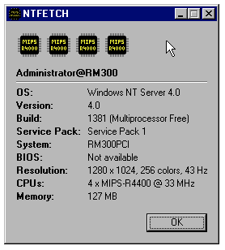

# ntfetch

A small [neofetch](https://github.com/dylanaraps/neofetch) for Windows NT.
Unlike neofetch it is a graphical app: one window, in the style of the NT 4.0 `winmsd`.

It runs on every Windows NT, from NT 3.1 to Windows 11.



## What it shows

- `user@HOST` as the title
- OS, version, build and service pack
- System maker and model
- BIOS version and date
- Screen resolution, colors and refresh rate
- CPUs: how many, name and speed, like `4 x MIPS-R4400 @ 150 MHz`
- One chip icon per CPU, showing its type
- Memory

The chips sit on top, four to a row.
The chip icons come from [WinTown](https://github.com/tenox7/WinTown) and [NT Games](https://github.com/tenox7/ntgames):
x86, x64, MIPS R3000 and R4000, Alpha AXP, AXP64, PowerPC, ARM, ARM64 and Itanium.
The program's own icon is a chip with a question mark. It also stands in for an unknown CPU.

A 32-bit ntfetch on 64-bit Windows shows the real CPU type, x64 or ARM64.

## Text mode

For debugging, `--text` prints the same information as text:

```
ntfetch --text
ntfetch --text > info.txt
ntfetch --text | more
```

`-text` and `/text` work too.

- Windows XP and later: it prints into the console you started it from.
- Older NT: it opens its own console and waits for Enter.
  `> info.txt` and `| more` work as usual.

## Building

You need `nmake` and a Microsoft C compiler:

- the Win32 SDK for Windows NT 3.1, or
- any Visual C++, from 2.0 up.

Then run:

```
nmake
```

The Makefile finds out which compiler it has and sets the flags for it.
`nmake clean` removes the build files.

Where the exe runs depends on the compiler:

| Compiler                    | Runs on                          |
|-----------------------------|----------------------------------|
| NT 3.1 SDK, Visual C++ 2.0  | NT 3.1 and later                 |
| Visual C++ 4.x              | NT 4.0 and later                 |
| Newer Visual C++            | what that compiler supports      |

For RISC (MIPS, Alpha, PowerPC, ARM, Itanium) build with that platform's compiler,
as for [WinTown](https://github.com/tenox7/WinTown#compile-for-risc).

